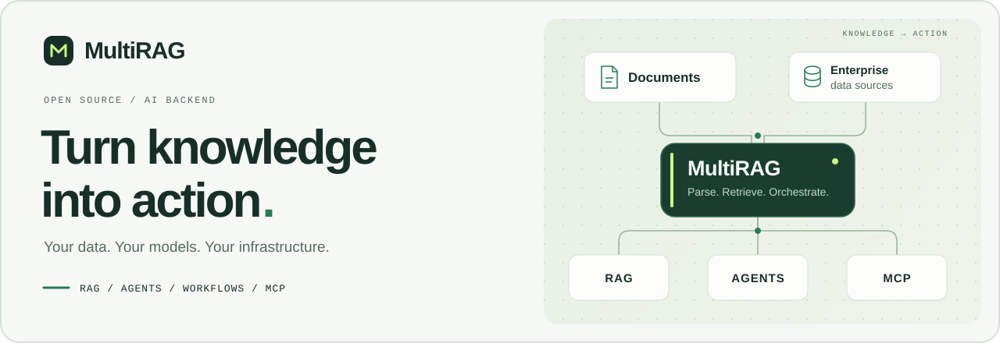
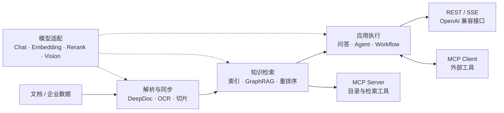

<p align="center">
  <picture>
    <source media="(prefers-color-scheme: dark)" srcset="./.github/assets/readme-hero-dark.svg">
    
  </picture>
</p>

<h1 align="center">MultiRAG</h1>

<p align="center">
  <strong>让企业知识，成为 AI 的行动力。</strong><br>
  从文档理解、混合检索到 Agent 与工具编排，构建属于你的 AI 后端。
</p>

<p align="center">
  <a href="./pyproject.toml"></a>
  <a href="./pyproject.toml"></a>
  <a href="./api/apps/__init__.py"></a>
  <a href="./LICENSE"></a>
</p>

<p align="center">
  <strong>简体中文</strong> · <a href="./README_EN.md">English</a>
</p>

<p align="center">
  <a href="#self-hosting">快速开始</a> ·
  <a href="#capabilities">核心能力</a> ·
  <a href="#api">API</a> ·
  <a href="#documentation">文档</a> ·
  <a href="#contributing">贡献</a>
</p>

---

<a id="overview"></a>

## 从数据到上下文，再到行动

MultiRAG 是面向知识密集型应用的开源 AI 后端，将 **文档解析 → 知识索引 → 检索问答 → Agent / Workflow → 工具调用** 串成一条可自主托管、可扩展的链路。

你可以用它构建带来源引用的企业知识助手、持续同步的内部搜索、处理复杂文档的服务，或连接业务工具的 Agent。通过 REST、SSE、OpenAI 兼容接口与 MCP，将这些能力接入自己的产品。

本仓库提供 **Python / FastAPI 后端、后台任务执行器与集成模块**，Web 客户端独立维护。

<a id="capabilities"></a>

## 一套后端，连接知识与工具

<table>
  <tr>
    <td width="50%" valign="top">
      <h3>01 / 理解复杂文档</h3>
      <p>PDF、Office、图片与音频解析；DeepDoc、OCR、版面分析、表格处理，以及可配置的 PDF Vision、PaddleOCR、Docling 链路。</p>
      <a href="./deepdoc/README_zh.md">查看文档解析 →</a>
    </td>
    <td width="50%" valign="top">
      <h3>02 / 找到可用的上下文</h3>
      <p>RAG、GraphRAG、混合召回与重排序；结合文档元数据过滤、父子块和来源引用，支持知识库检索与问答。</p>
      <a href="./docs/knowledge-base-guide.md">构建知识库 →</a>
    </td>
  </tr>
  <tr>
    <td width="50%" valign="top">
      <h3>03 / 编排多步骤任务</h3>
      <p>通过 Agent、Canvas 和 Workflow 连接模型、检索、条件分支与工具；支持文件输入、循环和文档生成等组件。</p>
      <a href="./agent/component">浏览 Agent 组件 →</a>
    </td>
    <td width="50%" valign="top">
      <h3>04 / 双向连接 MCP</h3>
      <p>Agent 作为 Client 调用外部工具；独立 MCP Server 对外提供数据集目录与检索。支持 Streamable HTTP，并保留 legacy SSE 兼容。</p>
      <a href="./mcp/README.md">接入 MCP →</a>
    </td>
  </tr>
  <tr>
    <td width="50%" valign="top">
      <h3>05 / 接入分散的数据</h3>
      <p>连接代码仓库、协作平台、云盘、消息系统和关系数据库，通过同步任务将业务资料接入知识库。</p>
      <a href="./common/data_source/README.md">查看数据连接器 →</a>
    </td>
    <td width="50%" valign="top">
      <h3>06 / 接入自己的应用</h3>
      <p>REST 资源接口、流式对话、OpenAI 兼容补全与管理 CLI；通过 Docker Compose 部署，按需选择模型、存储与检索后端。</p>
      <a href="./docs/references/http_api_reference.md">查看 API 参考 →</a>
    </td>
  </tr>
</table>

### 按你的技术栈组合

| 层 | 可选集成 |
| :--- | :--- |
| 模型 | OpenAI、Anthropic、Gemini、通义、Ollama、OpenAI 兼容服务等；覆盖 Chat、Embedding、Rerank、Vision、TTS 与语音识别 |
| 检索 | Milvus、Infinity、Elasticsearch、OpenSearch、OceanBase、SeekDB |
| 数据接入 | GitHub / GitLab / Bitbucket、Jira / Confluence / Notion / Moodle、Google Drive / SharePoint / Box / Dropbox / WebDAV、Slack / Teams / Gmail、MySQL / PostgreSQL 等 |
| 基础设施 | PostgreSQL、Redis / Valkey；MinIO、S3、OSS、Azure 等对象存储适配 |

完整实现见 [模型适配](./core/llm/README.md)、[模型目录](./configs/llm_factories.json)、[连接器](./common/data_source)与[检索后端](./common/doc_store)。具体模型、解析器和外部系统需配置相应凭据、服务或本地资源。

<a id="architecture"></a>

## 工作方式



API 服务处理请求，后台任务执行器负责解析、索引和同步等工作；MCP Server 是单独启动的服务。数据持久化由关系数据库、对象存储与所选检索引擎共同承担。

<a id="-快速开始"></a>
<a id="self-hosting"></a>

## 快速开始

### 使用 Docker Compose 自主托管

建议从 **4 核 CPU / 16 GB 内存**起步，复杂 OCR、大模型或较大数据集需要更多资源。使用 Docker 24+、Docker Compose 2.26+；本地构建还需要 [uv](https://docs.astral.sh/uv/)。默认镜像构建目标为 `linux/amd64`。

**1. 获取代码并准备镜像**

```bash
git clone https://github.com/yuehong136/MultiRAG.git
cd MultiRAG

# 下载构建资源，构建依赖镜像和主镜像
./scripts/build_docker_image.sh multirag:latest
```

已有可用镜像时，在 [`docker/.env`](./docker/.env) 设置 `MULTIRAG_IMAGE` 使用对应标签即可；部署时应固定经过验证的镜像版本。构建资源与运行时 embedding / rerank 模型分开管理，见下方说明。

**2. 配置服务**

检查 [`docker/.env`](./docker/.env) 中的端口、数据库和对象存储凭据。容器启动时根据 [`service_conf.yaml.template`](./docker/service_conf.yaml.template) 生成运行配置；模型配置可通过其中的 `LLM_*`、`CHAT_MODEL_*` 等变量提供。真实凭据不应提交到仓库。

**3. 启动 CPU + Milvus 组合**

```bash
cd docker
export DOC_ENGINE=milvus DEVICE=cpu

docker compose --profile cpu --profile milvus config --quiet
docker compose --profile cpu --profile milvus up -d
docker logs --tail 100 -f multirag
```

该组合会启动主服务、PostgreSQL、Redis / Valkey、对象存储及 Milvus 相关服务。默认 API 地址为 `http://localhost:8123`，可通过 `SVR_HTTP_PORT` 调整。

**4. 检查服务，再配置知识库**

```bash
# 连通性：预期返回 pong
curl --fail-with-body http://localhost:8123/api/v1/system/ping

# 就绪检查：查看数据库、缓存、存储等组件状态
curl --fail-with-body http://localhost:8123/api/v1/system/healthz
```

接下来配置 Chat / Embedding 模型，按[知识库使用指南](./docs/knowledge-base-guide.md)完成创建知识库、导入资料、解析和检索测试。`ping` 只确认 API 可达；知识问答还需要模型配置、后台任务执行与索引就绪。

<details>
<summary><strong>切换检索引擎、使用 GPU 或 Apple Silicon</strong></summary>

替换检索引擎时，让 `DOC_ENGINE` 与启用的 profile 保持一致，例如：

```bash
DOC_ENGINE=infinity DEVICE=cpu \
  docker compose --profile cpu --profile infinity up -d

DOC_ENGINE=milvus DEVICE=gpu \
  docker compose --profile gpu --profile milvus --profile tei-gpu up -d
```

命令在 `docker/` 目录执行。`.env` 会依据 `DOC_ENGINE` 与 `DEVICE` 设置默认 profiles；使用额外的 `--profile` 时注意它们会叠加。

Apple Silicon 使用专用 Compose 文件，并在容器运行时启用 x86_64 仿真：

```bash
DOC_ENGINE=milvus DEVICE=cpu \
  docker compose -f docker-compose-macos.yml --profile cpu --profile milvus up -d
```

GPU、TEI、Sandbox、Channel、HTTPS 与 Linux 内核参数等配置见 [Docker 部署文档](./docker/README.md)；Channel 的独立 supervisor 与凭据要求见 [Channel 运行说明](./api/channels/README.md)。

</details>

<details>
<summary><strong>运行时模型、仅镜像部署与数据库升级</strong></summary>

主镜像不内置 embedding / rerank 运行时模型。宿主机通过 `MULTIRAG_MODEL_DIR` 挂载到容器内 `/root/.ragdatav`，目录按模型 basename 平铺，例如 `models/bge-reranker-v2-m3/`。使用本地模型时需提前准备完整文件；Compose 默认只读挂载该目录。

从仓库根目录准备模型：

```bash
uv run --script download_deps.py \
  --runtime-models-only --runtime-model-dir ./models
```

已有外部数据库、对象存储与检索服务时，可使用独立的 [`docker-compose-standalone.yml`](./docker/docker-compose-standalone.yml)，通过 `MULTIRAG_CONFIG_FILE` 挂载完整配置，无需复制源码。配置示例和模型挂载规则见 [Docker 部署文档](./docker/README.md)。

升级现有实例前，按[数据库迁移指南](./docs/database-migration.md)准备备份、核对 schema 与迁移状态，再安排升级。

</details>

<a id="development"></a>

## 从源码开发

Python 支持范围为 **`>=3.12,<3.14`**；uv 版本范围以 [`pyproject.toml`](./pyproject.toml) 为准。

```bash
uv sync --python 3.12 --group dev --frozen
uv run --script download_deps.py

# 只启动开发依赖；检索引擎需与 DOC_ENGINE 一致
export DOC_ENGINE=milvus
docker compose -f docker/docker-compose-base.yml --profile milvus up -d
```

将本机连接信息写入已忽略的 `configs/local.service_conf.yaml`，或使用 `MULTIRAG_<SECTION>__<FIELD>` 环境变量。源码进程连接容器映射到宿主机的地址和端口；文件覆盖按顶层 section 整体替换，详见[配置与资源](./docs/development.md#配置与资源)。

在仓库根目录用两个终端分别启动 API 和任务执行器，两个进程使用相同的配置与 `DOC_ENGINE`：

```bash
# 终端 A：API
uv run --no-sync python -m api.multirag_server

# 终端 B：文档解析、索引等后台任务
uv run --no-sync python -m core.svr.task_executor
```

| 目录 | 职责 |
| :--- | :--- |
| [`api/`](./api) | FastAPI 路由、认证、数据库模型与服务 |
| [`core/`](./core) / [`deepdoc/`](./deepdoc) | 模型适配、检索、解析、GraphRAG 与任务执行 |
| [`agent/`](./agent) / [`workflow/`](./workflow) / [`workflow_v2/`](./workflow_v2) | Agent 组件与工作流执行 |
| [`common/`](./common) | 配置、资源生命周期、连接器与存储适配 |
| [`mcp/`](./mcp) / [`admin/`](./admin) | MCP Server、示例客户端、管理服务与 CLI |
| [`docker/`](./docker) / [`tests/`](./tests) | 部署配置、验证与测试 |

当前生产后端的扩展入口是 Python 目录；`server/`、`cmd/` 与 `internal/` 中的 Go 并行实现处于停滞状态。

<a id="api"></a>

## API 与 MCP 接入

### REST API

业务路由挂载于 `/api/v1`，以下为当前接口示例：

| 方法 | 路径 | 用途 |
| :--- | :--- | :--- |
| `GET` / `POST` | `/api/v1/datasets` | 列出 / 创建知识库 |
| `POST` | `/api/v1/datasets/search` | 跨知识库检索 |
| `GET` | `/api/v1/datasets/{dataset_id}/documents/{document_id}/chunks` | 读取文档分块 |
| `PATCH` | `/api/v1/datasets/{dataset_id}/documents/{document_id}/chunks/{chunk_id}` | 更新分块 |
| `POST` | `/api/v1/chat/completions` | 消息式对话补全 |
| `POST` | `/api/v1/agents/chat/completions` | 执行 Agent / Canvas |

使用有效 API Key 访问受保护的业务接口，例如：

```bash
# 先设置 MULTIRAG_API_KEY 为你的 API Key
curl --fail-with-body http://localhost:8123/api/v1/datasets \
  -H "Authorization: Bearer ${MULTIRAG_API_KEY}"
```

请求字段、认证与流式响应详见 [HTTP API 参考](./docs/references/http_api_reference.md)和 [REST 接口说明](./api/apps/restful_apis/README.md)。运行中的服务提供 `/openapi.json`；内置 `/docs` 与 `/redoc` 页面默认关闭。

### MCP

- **出站 Client**：Agent 调用配置好的外部 MCP Server。
- **入站 Server**：独立进程通过 `/mcp` 提供 `list_datasets`、`multirag_retrieval` 和 `datasets://list`；legacy `/sse` 保留兼容。

当前依赖锁定为 **FastMCP `4.0.0b3`（beta）与 MCP SDK `2.0.0`**。启动方式、传输兼容、安全配置与实现边界以 [MCP 模块说明](./mcp/README.md)为准。

<a id="documentation"></a>

## 继续探索

| 你想做什么 | 从这里开始 |
| :--- | :--- |
| 创建知识库，检查资料与检索效果 | [知识库使用指南](./docs/knowledge-base-guide.md) |
| 部署、配置 HTTPS、挂载模型或诊断容器 | [Docker 部署](./docker/README.md) |
| 升级数据库与准备恢复 | [数据库迁移](./docs/database-migration.md) |
| 开发后端与运行测试 | [开发细则](./docs/development.md) · [测试说明](./tests/README.md) |
| 对接 REST 或 MCP | [HTTP API](./docs/references/http_api_reference.md) · [MCP](./mcp/README.md) |
| 接入外部消息渠道 | [Channel](./api/channels/README.md) |
| 了解企业身份与 MCP 授权设计 | [EIM 项目](./docs/enterprise-identity-mcp/README.md) |
| 了解持久化远程运行的目标设计 | [Run Platform](./docs/run-platform/README.md)（设计与实现进度见该文档） |

<a id="contributing"></a>

## 一起构建

欢迎通过 [Issue](https://github.com/yuehong136/MultiRAG/issues) 反馈问题，通过 [Pull Request](https://github.com/yuehong136/MultiRAG/pulls) 贡献改进。开始前阅读 [协作规范](./AGENTS.md)与[开发细则](./docs/development.md)。

按改动范围运行检查：文档修改核对内容、路径与链接；代码修改运行相关文件的 lint 和单测；存储、检索或协议变更补充对应集成检查。常用入口：

| 命令 | 检查范围 |
| :--- | :--- |
| `make lint` / `make typecheck` / `make test` | 分别运行静态检查、类型检查、单元测试 |
| `make integration` | 在隔离资源上运行核心集成测试，可通过 `TESTS=...` 限定范围 |
| `make smoke` | 检查已运行服务的健康端点 |
| `make mcp-compat` | MCP modern / legacy 双向协议兼容矩阵 |

完整本地 Python 检查可显式运行 `make verify`；最终组合由适用 CI 检查把关。更多分组与环境要求见[测试说明](./tests/README.md)。安全问题请遵循 [安全政策](./SECURITY.md)。

---

<p align="center">
  <strong>MultiRAG</strong> · Knowledge into action.<br>
  以 <a href="./LICENSE">Apache License 2.0</a> 开源。
</p>
