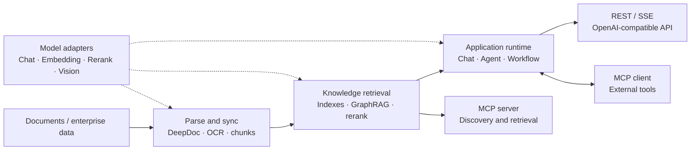

<p align="center">
  <picture>
    <source media="(prefers-color-scheme: dark)" srcset="./.github/assets/readme-hero-dark.svg">
    
  </picture>
</p>

<h1 align="center">MultiRAG</h1>

<p align="center">
  <strong>Turn your organization's knowledge into action.</strong><br>
  Build your AI backend, from document understanding and retrieval to agents and tools.
</p>

<p align="center">
  <a href="./pyproject.toml"></a>
  <a href="./pyproject.toml"></a>
  <a href="./api/apps/__init__.py"></a>
  <a href="./LICENSE"></a>
</p>

<p align="center">
  <a href="./README.md">简体中文</a> · <strong>English</strong>
</p>

<p align="center">
  <a href="#self-hosting">Quick start</a> ·
  <a href="#capabilities">Features</a> ·
  <a href="#api">API</a> ·
  <a href="#documentation">Docs</a> ·
  <a href="#contributing">Contribute</a>
</p>

---

<a id="overview"></a>

## From data to context to action

MultiRAG is an open-source AI backend for knowledge-intensive applications. It connects **document parsing → knowledge indexing → retrieval and answers → agents / workflows → tool calls** in a stack you can host and extend.

Build a knowledge assistant with source citations, internal search with scheduled data sync, a document processing service, or an agent connected to business tools. Integrate through REST, SSE, OpenAI-compatible endpoints and MCP.

This repository contains the **Python / FastAPI backend, background task executor and integrations**. The Web client is maintained separately.

<a id="capabilities"></a>

## One backend for knowledge and tools

<table>
  <tr>
    <td width="50%" valign="top">
      <h3>01 / Understand documents</h3>
      <p>Parse PDFs, Office files, images and audio. Use DeepDoc, OCR, layout analysis and table processing, with configurable PDF Vision, PaddleOCR and Docling paths.</p>
      <a href="./deepdoc/README.md">Explore document parsing →</a>
    </td>
    <td width="50%" valign="top">
      <h3>02 / Retrieve useful context</h3>
      <p>Combine RAG, GraphRAG, hybrid retrieval and reranking with document metadata filters, parent-child chunks and source citations for search and answers.</p>
      <a href="./docs/knowledge-base-guide.md">Build a knowledge base →</a>
    </td>
  </tr>
  <tr>
    <td width="50%" valign="top">
      <h3>03 / Orchestrate tasks</h3>
      <p>Connect models, retrieval, branches and tools through agents, Canvas and workflows. Components include file inputs, loops and document generation.</p>
      <a href="./agent/component">Browse agent components →</a>
    </td>
    <td width="50%" valign="top">
      <h3>04 / Connect through MCP</h3>
      <p>Call external tools as an MCP client, or expose dataset discovery and retrieval through a separate MCP server. Use Streamable HTTP with legacy SSE compatibility.</p>
      <a href="./mcp/README.md">Integrate MCP →</a>
    </td>
  </tr>
  <tr>
    <td width="50%" valign="top">
      <h3>05 / Bring your data</h3>
      <p>Connect code repositories, collaboration platforms, cloud drives, messaging systems and relational databases. Sync business content into your knowledge base.</p>
      <a href="./common/data_source/README.md">Explore connectors →</a>
    </td>
    <td width="50%" valign="top">
      <h3>06 / Build your application</h3>
      <p>Use REST resources, streaming conversations, OpenAI-compatible completions and an admin CLI. Deploy with Docker Compose and choose your models, storage and retrieval engine.</p>
      <a href="./docs/references/http_api_reference.md">Read the API reference →</a>
    </td>
  </tr>
</table>

### Compose your stack

| Layer | Integrations |
| :--- | :--- |
| Models | OpenAI, Anthropic, Gemini, Tongyi, Ollama, OpenAI-compatible services and more; Chat, Embedding, Rerank, Vision, TTS and speech recognition |
| Retrieval | Milvus, Infinity, Elasticsearch, OpenSearch, OceanBase, SeekDB |
| Data sources | GitHub / GitLab / Bitbucket, Jira / Confluence / Notion / Moodle, Google Drive / SharePoint / Box / Dropbox / WebDAV, Slack / Teams / Gmail, MySQL / PostgreSQL and more |
| Infrastructure | PostgreSQL, Redis / Valkey; object storage adapters for MinIO, S3, OSS, Azure and more |

See [model adapters](./core/llm/README.md), the [model catalog](./configs/llm_factories.json), [connectors](./common/data_source) and [retrieval backends](./common/doc_store) for implementations. Models, parsers and external systems require their respective credentials, services or local resources.

<a id="architecture"></a>

## How it works



The API handles requests; the background task executor handles parsing, indexing and sync jobs. The MCP server runs separately. A relational database, object storage and the selected retrieval engine provide persistence.

<a id="self-hosting"></a>

## Quick start

### Self-host with Docker Compose

Start with **4 CPU cores / 16 GB RAM**; complex OCR, large models or larger datasets need more resources. Use Docker 24+ and Docker Compose 2.26+. Building locally also requires [uv](https://docs.astral.sh/uv/). The default image build targets `linux/amd64`.

**1. Get the code and prepare an image**

```bash
git clone https://github.com/yuehong136/MultiRAG.git
cd MultiRAG

# Download build resources, then build the dependency and application images
./scripts/build_docker_image.sh multirag:latest
```

If you already have an application image, set `MULTIRAG_IMAGE` in [`docker/.env`](./docker/.env) to its tag. Pin a validated image version for deployment. Build resources and runtime embedding / rerank models are managed separately, as described below.

**2. Configure services**

Review ports, database credentials and object storage credentials in [`docker/.env`](./docker/.env). At startup, the container generates its configuration from [`service_conf.yaml.template`](./docker/service_conf.yaml.template). Model settings can be supplied through its `LLM_*`, `CHAT_MODEL_*` and related variables. Keep real credentials out of version control.

**3. Start CPU + Milvus**

```bash
cd docker
export DOC_ENGINE=milvus DEVICE=cpu

docker compose --profile cpu --profile milvus config --quiet
docker compose --profile cpu --profile milvus up -d
docker logs --tail 100 -f multirag
```

This starts the application, PostgreSQL, Redis / Valkey, object storage and the Milvus services. The default API address is `http://localhost:8123`; change it with `SVR_HTTP_PORT`.

**4. Check services, then configure a knowledge base**

```bash
# Connectivity: expect pong
curl --fail-with-body http://localhost:8123/api/v1/system/ping

# Readiness: inspect database, cache, storage and other component states
curl --fail-with-body http://localhost:8123/api/v1/system/healthz
```

Configure Chat / Embedding models, then follow the [knowledge base guide](./docs/knowledge-base-guide.md) to create a dataset, import content, parse it and test retrieval. `ping` confirms API connectivity; knowledge answers also require configured models, background execution and ready indexes.

<details>
<summary><strong>Other retrieval engines, GPU and Apple Silicon</strong></summary>

Keep `DOC_ENGINE` aligned with the enabled profile when switching retrieval engines:

```bash
DOC_ENGINE=infinity DEVICE=cpu \
  docker compose --profile cpu --profile infinity up -d

DOC_ENGINE=milvus DEVICE=gpu \
  docker compose --profile gpu --profile milvus --profile tei-gpu up -d
```

Run these commands from `docker/`. The `.env` file derives default profiles from `DOC_ENGINE` and `DEVICE`; additional `--profile` flags are additive.

On Apple Silicon, use the dedicated Compose file and enable x86_64 emulation in your container runtime:

```bash
DOC_ENGINE=milvus DEVICE=cpu \
  docker compose -f docker-compose-macos.yml --profile cpu --profile milvus up -d
```

See [Docker deployment](./docker/README.md) for GPU, TEI, Sandbox, Channel, HTTPS and Linux kernel settings. For the separate Channel supervisor and its credentials, see [Channel operations](./api/channels/README.md).

</details>

<details>
<summary><strong>Runtime models, image-only deployment and database upgrades</strong></summary>

The application image does not bundle runtime embedding / rerank models. `MULTIRAG_MODEL_DIR` mounts a host directory at `/root/.ragdatav`. Place each model under its basename, such as `models/bge-reranker-v2-m3/`. Prepare complete files before using local models; Compose mounts this directory read-only by default.

Prepare models from the repository root:

```bash
uv run --script download_deps.py \
  --runtime-models-only --runtime-model-dir ./models
```

With external database, object storage and retrieval services already available, use [`docker-compose-standalone.yml`](./docker/docker-compose-standalone.yml). Mount a complete configuration with `MULTIRAG_CONFIG_FILE`; no source checkout is required. See [Docker deployment](./docker/README.md) for configuration and model mount details.

Before upgrading an existing instance, follow the [database migration guide](./docs/database-migration.md) to prepare backups and check schema and migration state.

</details>

<a id="development"></a>

## Develop from source

Python **`>=3.12,<3.14`** is supported. The required uv range is declared in [`pyproject.toml`](./pyproject.toml).

```bash
uv sync --python 3.12 --group dev --frozen
uv run --script download_deps.py

# Start development dependencies; match the retrieval engine to DOC_ENGINE
export DOC_ENGINE=milvus
docker compose -f docker/docker-compose-base.yml --profile milvus up -d
```

Put local connection settings in the ignored `configs/local.service_conf.yaml`, or use `MULTIRAG_<SECTION>__<FIELD>` environment variables. Source processes connect through host addresses and mapped ports. File overrides replace entire top-level sections; see [configuration and resources](./docs/development.md#配置与资源).

From the repository root, start the API and task executor in separate terminals. Both processes need the same configuration and `DOC_ENGINE`:

```bash
# Terminal A: API
uv run --no-sync python -m api.multirag_server

# Terminal B: parsing, indexing and other background tasks
uv run --no-sync python -m core.svr.task_executor
```

| Directory | Responsibility |
| :--- | :--- |
| [`api/`](./api) | FastAPI routes, authentication, database models and services |
| [`core/`](./core) / [`deepdoc/`](./deepdoc) | Model adapters, retrieval, parsing, GraphRAG and task execution |
| [`agent/`](./agent) / [`workflow/`](./workflow) / [`workflow_v2/`](./workflow_v2) | Agent components and workflow execution |
| [`common/`](./common) | Configuration, resource lifecycle, connectors and storage adapters |
| [`mcp/`](./mcp) / [`admin/`](./admin) | MCP server, example clients, admin service and CLI |
| [`docker/`](./docker) / [`tests/`](./tests) | Deployment configuration, validation and tests |

Extend the Python backend for production work. The parallel Go implementations in `server/`, `cmd/` and `internal/` are currently inactive.

<a id="api"></a>

## API and MCP access

### REST API

Business routes are mounted under `/api/v1`. Current examples include:

| Method | Path | Purpose |
| :--- | :--- | :--- |
| `GET` / `POST` | `/api/v1/datasets` | List / create knowledge bases |
| `POST` | `/api/v1/datasets/search` | Search across knowledge bases |
| `GET` | `/api/v1/datasets/{dataset_id}/documents/{document_id}/chunks` | Read document chunks |
| `PATCH` | `/api/v1/datasets/{dataset_id}/documents/{document_id}/chunks/{chunk_id}` | Update a chunk |
| `POST` | `/api/v1/chat/completions` | Message-based chat completion |
| `POST` | `/api/v1/agents/chat/completions` | Execute an agent / Canvas |

Use a valid API key for protected business endpoints:

```bash
# Set MULTIRAG_API_KEY to your API key first
curl --fail-with-body http://localhost:8123/api/v1/datasets \
  -H "Authorization: Bearer ${MULTIRAG_API_KEY}"
```

See the [HTTP API reference](./docs/references/http_api_reference.md) and [REST interface notes](./api/apps/restful_apis/README.md) for payloads, authentication and streaming responses. A running service exposes `/openapi.json`; built-in `/docs` and `/redoc` pages are disabled by default.

### MCP

- **Outbound client**: agents call configured external MCP servers.
- **Inbound server**: a separate process exposes `list_datasets`, `multirag_retrieval` and `datasets://list` through `/mcp`; legacy `/sse` remains available.

Dependencies are pinned to **FastMCP `4.0.0b3` (beta) and MCP SDK `2.0.0`**. See the [MCP module guide](./mcp/README.md) for startup, transport compatibility, security configuration and implementation boundaries.

<a id="documentation"></a>

## Explore further

Most detailed guides are currently written in Chinese.

| Your next step | Start here |
| :--- | :--- |
| Create a knowledge base and evaluate retrieval | [Knowledge base guide](./docs/knowledge-base-guide.md) |
| Deploy, configure HTTPS, mount models or diagnose containers | [Docker deployment](./docker/README.md) |
| Upgrade a database and prepare recovery | [Database migration](./docs/database-migration.md) |
| Develop the backend and run tests | [Development](./docs/development.md) · [Testing](./tests/README.md) |
| Integrate REST or MCP | [HTTP API](./docs/references/http_api_reference.md) · [MCP](./mcp/README.md) |
| Connect external messaging channels | [Channel](./api/channels/README.md) |
| Explore enterprise identity and MCP authorization design | [EIM project](./docs/enterprise-identity-mcp/README.md) |
| Explore the target design for durable remote runs | [Run Platform](./docs/run-platform/README.md) (see its design and implementation status) |

<a id="contributing"></a>

## Build with us

Report problems through [Issues](https://github.com/yuehong136/MultiRAG/issues) and contribute improvements through [Pull Requests](https://github.com/yuehong136/MultiRAG/pulls). Read the [collaboration rules](./AGENTS.md) and [development guide](./docs/development.md) before you start.

Choose checks by scope: validate content, paths and links for documentation; run focused lint and unit tests for code; add the appropriate integration checks for storage, retrieval or protocol changes. Common entry points:

| Command | Scope |
| :--- | :--- |
| `make lint` / `make typecheck` / `make test` | Static checks, type checks and unit tests, respectively |
| `make integration` | Core integration tests with isolated resources; narrow the selection with `TESTS=...` |
| `make smoke` | Health endpoints on an already running service |
| `make mcp-compat` | MCP modern / legacy protocol compatibility in both directions |

Use `make verify` when you need the full local Python checks. Applicable CI checks validate the final combination. See [Testing](./tests/README.md) for suites and environment requirements. Follow the [security policy](./SECURITY.md) to report vulnerabilities.

---

<p align="center">
  <strong>MultiRAG</strong> · Knowledge into action.<br>
  Open source under the <a href="./LICENSE">Apache License 2.0</a>.
</p>
