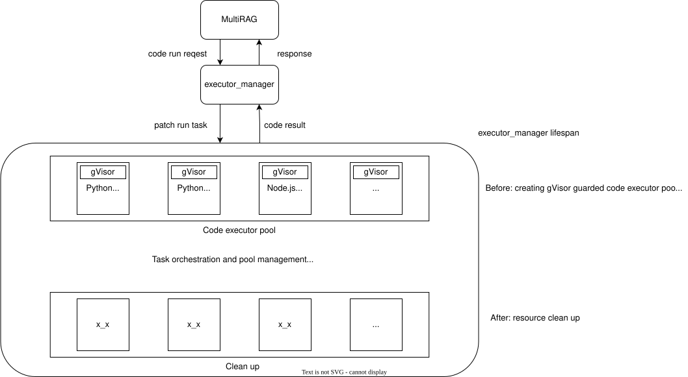

# MultiRAG Sandbox

A pluggable code execution backend for MultiRAG. Container isolation applies to
the self-managed provider; the opt-in local provider runs host processes.

## 🔧 Features

- ✅ **Seamless MultiRAG Integration** — Out-of-the-box compatibility with the `code` component.
- 🔐 **High Security** — Leverages [gVisor](https://gvisor.dev/) for syscall-level sandboxing.
- 🔧 **Customizable Sandboxing** — Easily modify `seccomp` settings as needed.
- 🧩 **Pluggable Runtime Support** — Easily extend to support any programming language.
- ⚙️ **Developer Friendly** — Get started with a single command using `Makefile`.

## Provider selection and local development

The Agent **Code** component (`CodeExec`) runs Python or JavaScript through a
sandbox provider. Configure the provider in the Python API and worker processes
that execute the workflow before using the editor or single-step debug.

`SANDBOX_PROVIDER_TYPE` overrides the `sandbox.provider_type` system setting.
When neither selects a provider, CodeExec may use the existing HTTP executor.
A selected provider's invalid configuration, missing dependency, timeout or
execution error is reported through `_ERROR`; it does not retry on another
backend. Nonzero exits clear stale business and attachment outputs.

For `local`, `SANDBOX_LOCAL_*` fields override the `sandbox.local` JSON system
setting, followed by the provider defaults. For `self_managed`, `SANDBOX_HOST`,
`SANDBOX_EXECUTOR_MANAGER_PORT` (when `SANDBOX_HOST` is supplied) and
`SANDBOX_EXECUTOR_MANAGER_POOL_SIZE` override its endpoint/pool settings. An explicit environment selection can initialize
from environment/defaults when the settings DB is unavailable; malformed saved
JSON remains an error. Other provider credentials retain their existing rules.
The client caches successful initialization; `reload_provider()` invalidates
that cache for the next call. Local execution checks its enable flag at
initialization, so changing the flag requires cache invalidation as well.

Local execution requires a POSIX host, Python and (for JavaScript) Node.js. It is
**not a security sandbox**: code can access the runtime account's files and
network, spawn processes or evade resource limits. Enable it only for trusted
code under a low-privilege account. It is never selected or enabled by default.
The Docker manager does not need to run for this provider. Example environment
for a dedicated development process:

```sh
export SANDBOX_ENABLED=1
export SANDBOX_PROVIDER_TYPE=local
export SANDBOX_LOCAL_ENABLED=true
export SANDBOX_LOCAL_PYTHON_BIN=python3
export SANDBOX_LOCAL_NODE_BIN=node
export SANDBOX_LOCAL_WORK_DIR=/tmp/multirag-codeexec
```

The commented [environment example](../../docker/.env) lists all limits.
To limit native math threads when NumPy/OpenBLAS reports `pthread_create failed`,
set `OPENBLAS_NUM_THREADS`, `OMP_NUM_THREADS`, `MKL_NUM_THREADS`,
`NUMEXPR_NUM_THREADS`, `BLIS_NUM_THREADS` and `VECLIB_MAXIMUM_THREADS` to `1` in
the execution process environment. Only these six optional controls are
forwarded alongside the small environment below; unset controls remain unset.
Install extra Python packages into the interpreter selected by
`SANDBOX_LOCAL_PYTHON_BIN`, not the executor-manager environment.


Defaults: timeout 30 seconds, memory 512 MiB, combined stdout/stderr 1 MiB,
20 artifacts, and 10 MiB per artifact. Requested timeout is capped by the
provider timeout. Output is bounded while reading; timeout, output overflow and
normal completion kill the execution process group. A fresh interpreter applies
CPU, file-size and descriptor limits before starting user code, avoiding
`preexec_fn` in the threaded server. Python address-space limits apply on Linux;
macOS does not enforce that memory cap. Node uses `--max-old-space-size`, which
limits its managed heap, not total process memory. These are resource controls,
not isolation guarantees.

Each instance gets its own `0700` temporary directory. The child receives a
small environment (HOME/TMPDIR point there, PATH, Agg plotting backend and BLAS
thread controls); application credentials are not forwarded. Scripts and files
are removed when the client destroys the instance, including after failure.
Only regular files below `artifacts/` are collected, with count/size limits;
symlinks, hardlinks and special files are rejected, including replacement of
the artifact root. Supported suffixes: CSV, HTML, JPEG/JPG, JSON, PDF, PNG, SVG.
Existing upload-time ownership bindings and REST download checks still apply.

Both local and Aliyun use the shared result protocol: Python calls
`main(**arguments)` and JavaScript awaits `main(arguments)` (also supporting
`module.exports.main`). Return JSON values, including `false` and `null`;
JavaScript `undefined`, exceptions and nonserializable values are failures.
Structured return values are separate from stdout logs and artifacts.

## 🏗 Architecture

<p align="center">
  
</p>

## 🚀 Quick Start

Commands in the following container quickstart run from `agent/sandbox/`
(relative to the repository root). These prerequisites apply to `self_managed`;
the `local` development provider does not require Docker or gVisor.

### 📋 Prerequisites

#### Required

- Linux distro compatible with gVisor
- [gVisor](https://gvisor.dev/docs/user_guide/install/)
- Docker >= `25.0` (API 1.44+) — executor manager now bundles Docker CLI `29.1.0` to match newer daemons.
- Docker Compose >= `v2.26.1` like [MultiRAG](https://github.com/yuehong136/MultiRAG)
- [uv](https://docs.astral.sh/uv/) as package and project manager

#### Optional (Recommended)

- [GNU Make](https://www.gnu.org/software/make/) for simplified CLI management

---

> ⚠️ **New Docker CLI requirement**
>
> If you see `client version 1.43 is too old. Minimum supported API version is 1.44`, pull the latest `infiniflow/sandbox-executor-manager:latest` (rebuilt with Docker CLI `29.1.0`) or rebuild it in `./executor_manager`. Older images shipped Docker 24.x, which cannot talk to newer Docker daemons.

### 🐳 Build Docker Base Images

We use isolated base images for secure containerized execution:

```bash
# Build base images manually
docker build -t sandbox-base-python:latest ./sandbox_base_image/python
docker build -t sandbox-base-nodejs:latest ./sandbox_base_image/nodejs

# OR use Makefile
make build
```

Then, build the executor manager image:

```bash
docker build -t sandbox-executor-manager:latest ./executor_manager
```

For published runtime images, tag them with the names used by standalone Compose:

```bash
docker pull infiniflow/sandbox-base-python:latest
docker pull infiniflow/sandbox-base-nodejs:latest
docker tag infiniflow/sandbox-base-python:latest sandbox-base-python:latest
docker tag infiniflow/sandbox-base-nodejs:latest sandbox-base-nodejs:latest
```

The main Docker Compose deployment instead reads the image names from
`docker/.env`; keep `SANDBOX_BASE_PYTHON_IMAGE` and `SANDBOX_BASE_NODEJS_IMAGE`
aligned with the images available on that Docker host.

All three Dockerfiles default to `NEED_MIRROR=1`, using the Tsinghua apt/Python
mirrors and the npm mirror where applicable. To use the upstream Debian, PyPI
and npm registries instead, pass `--build-arg NEED_MIRROR=0` to each manual build:

```bash
docker build --build-arg NEED_MIRROR=0 -t sandbox-base-python:latest ./sandbox_base_image/python
docker build --build-arg NEED_MIRROR=0 -t sandbox-base-nodejs:latest ./sandbox_base_image/nodejs
docker build --build-arg NEED_MIRROR=0 -t sandbox-executor-manager:latest ./executor_manager
```

---

### 📦 Running with MultiRAG

Choose the provider for the Python backend, using the environment example in
[`docker/.env`](../../docker/.env):

- `self_managed`: set `SANDBOX_PROVIDER_TYPE=self_managed`, configure
  `SANDBOX_HOST` and `SANDBOX_EXECUTOR_MANAGER_PORT`, and include `sandbox` in
  `COMPOSE_PROFILES` when the main Compose deployment manages the executor.
  gVisor and runtime base images are required on the executor's Docker host.
- `local`: set `SANDBOX_PROVIDER_TYPE=local` and `SANDBOX_LOCAL_ENABLED=true`,
  then configure the interpreter, working directory and limits above. The
  `sandbox` Compose profile is unnecessary. Inside a backend container, local
  code executes in that container under its runtime account.

For a host-run backend, export the variables in both the API and task-worker
process environments and use `uv run python -m api.multirag_server` and
`uv run python -m core.svr.task_executor` from the repository root (see
[service setup](../../docs/development.md#服务与运行)). Editing `docker/.env`
alone does not export values into a host process. With Compose, that file is
loaded into the main backend services by `env_file`.

`SANDBOX_ENABLED=1` enables the legacy `settings.SANDBOX_HOST` facade used by
HTTP fallback; it is not the opt-in gate for the explicit local provider.
`SANDBOX_ARTIFACT_BUCKET` and `SANDBOX_ARTIFACT_EXPIRE_DAYS` configure generated
file storage. Keep the backend's storage and Redis services configured: artifact
URLs are bound to the server-derived owner, run and optional Agent session.
For a host-run backend, map the executor hostname in `/etc/hosts` only if that
hostname does not already resolve. Compose services use their internal DNS.

#### Check the Code component

1. Add a Code node and select Python. Define `main()` and one business output
   whose type matches the returned JSON value. `attachments` is a reserved
   system output and must not be used as a business output name.
2. To generate a file, create `artifacts/` inside the execution directory:

   ```python
   from pathlib import Path

   def main() -> str:
       Path("artifacts").mkdir(exist_ok=True)
       Path("artifacts/report.csv").write_text("name,value\nexample,1\n")
       return "Report ready"
   ```

3. Run single-step debug. Check the business result and the attachments section;
   `attachments` contains Markdown image/download links that can also be
   referenced by downstream nodes. Downloading requires the same authenticated
   owner and matching run/session binding. A successful run with no files clears
   attachments, and an execution failure clears previous result/file outputs.

These setup instructions do not start, restart or upgrade an existing service.
Apply deployment changes through the [deployment procedure](../../docker/README.md).

---

### 🧭 Running Standalone

#### Manual Setup

1. Initialize environment:

   ```bash
   cp .env.example .env
   ```

2. Launch:

   ```bash
   docker compose -f docker-compose.yml up
   ```

3. Test:

   ```bash
   source .venv/bin/activate
   export PYTHONPATH=$(pwd)
   uv pip install -r executor_manager/requirements.txt
   uv run tests/sandbox_security_tests_full.py
   ```

#### With Make

```bash
make          # setup + build + launch + test
```

---

### 📈 Monitoring

```bash
docker logs -f sandbox-executor-manager  # Manual
make logs                                 # With Make
```

---

### 🧰 Makefile Toolbox

| Command           | Description                                      |
|-------------------|--------------------------------------------------|
| `make`            | Setup, build, launch and test all at once        |
| `make setup`      | Initialize environment and install uv            |
| `make ensure_env` | Auto-create `.env` if missing                    |
| `make ensure_uv`  | Install `uv` package manager if missing          |
| `make build`      | Build all Docker base images                     |
| `make start`      | Start services with safe env loading and testing |
| `make stop`       | Gracefully stop all services                     |
| `make restart`    | Shortcut for `stop` + `start`                    |
| `make test`       | Run full test suite                              |
| `make logs`       | Stream container logs                            |
| `make clean`      | Stop and remove orphan containers and volumes    |

---

## 🔐 Security

The MultiRAG sandbox is designed to balance security and usability, offering solid protection without compromising developer experience.

### ✅ gVisor Isolation

At its core, we use [gVisor](https://gvisor.dev/docs/architecture_guide/security/), a user-space kernel, to isolate code execution from the host system. gVisor intercepts and restricts syscalls, offering robust protection against container escapes and privilege escalations.

### 🔒 Optional seccomp Support (Advanced)

For users who need **zero-trust-level syscall control**, we support an additional `seccomp` profile. This feature restricts containers to only a predefined set of system calls, as specified in `executor_manager/seccomp-profile-default.json`.

> ⚠️ This feature is **disabled by default** to maintain compatibility and usability. Enabling it may cause compatibility issues with some dependencies.

#### To enable seccomp

1. Edit your `.env` file:

   ```dotenv
   SANDBOX_ENABLE_SECCOMP=true
   ```

2. Customize allowed syscalls in:

   ```
   executor_manager/seccomp-profile-default.json
   ```

   This profile is passed to the container with:

   ```bash
   --security-opt seccomp=/app/seccomp-profile-default.json
   ```

### 🧠 Python Code AST Inspection

In addition to sandboxing, Python code is **statically analyzed via AST (Abstract Syntax Tree)** before execution. Potentially malicious code (e.g. file operations, subprocess calls, etc.) is rejected early, providing an extra layer of protection.

---

This security model strikes a balance between **robust isolation** and **developer usability**. While `seccomp` can be highly restrictive, our default setup aims to keep things usable for most developers — no obscure crashes or cryptic setup required.

## 📦 Add Extra Dependencies for Supported Languages

Currently, the following languages are officially supported:

| Language | Priority |
|----------|----------|
| Python   | High     |
| Node.js  | Medium   |

### 🐍 Python

Pre-installed packages: `requests`, `numpy`, `pandas`, `matplotlib`.

> `matplotlib` uses the `Agg` (non-interactive) backend by default in the sandbox (`MPLBACKEND=Agg`). No display server is available, so always save figures to files (e.g. `fig.savefig("artifacts/chart.png")`) rather than calling `plt.show()`.
>
> Tip: if Chinese text renders as missing boxes/squares in `matplotlib`, install Debian package `fonts-noto-cjk` in your custom image. We do not preinstall it by default to keep the base image smaller. The sandbox base image ships a `matplotlibrc` that already lists common CJK fonts in the `font.sans-serif` fallback chain, so no code-level font configuration is needed — just install the font package and rebuild the image.
>
> Example:
>
> ```dockerfile
> RUN apt-get update && apt-get install -y --no-install-recommends fonts-noto-cjk && rm -rf /var/lib/apt/lists/*
> ```
To add more dependencies, edit:

```bash
sandbox_base_image/python/requirements.txt
```

Add any additional packages you need, one per line (just like a normal pip requirements file).

### 🟨 Node.js

To add Node.js dependencies:

1. Navigate to the Node.js base image directory:

   ```bash
   cd sandbox_base_image/nodejs
   ```

2. Use `npm` to install the desired packages. For example:

   ```bash
   npm install lodash
   ```

3. The dependencies will be saved to `package.json` and `package-lock.json`, and included in the Docker image when rebuilt.

---


## Usage

### 🐍 A Python example

```python
def main(arg1: str, arg2: str) -> str:
    return f"result: {arg1 + arg2}"
```

### 🟨 JavaScript examples

A simple sync function

```javascript
function main({arg1, arg2}) {
  return arg1+arg2
}
```

Async funcion with aioxs

```javascript
const axios = require('axios');
async function main() {
  try {
    const response = await axios.get('https://github.com/yuehong136/MultiRAG');
    return 'Body:' + response.data;
  } catch (error) {
    return 'Error:' + error.message;
  }
}
```

---

## 📋 FAQ

### ❓Sandbox Not Working?

Follow this checklist to troubleshoot:

- [ ] **Is your machine compatible with gVisor?**

  Ensure that your system supports gVisor. Refer to the [gVisor installation guide](https://gvisor.dev/docs/user_guide/install/).

- [ ] **Is gVisor properly installed?**

  **Common error:**

  `HTTPConnectionPool(host='sandbox-executor-manager', port=9385): Read timed out.`

  Cause: `runsc` is an unknown or invalid Docker runtime.
  **Fix:**

  - Install gVisor

  - Restart Docker

  - Test with:

    ```bash
    docker run --rm --runtime=runsc hello-world
    ```

- [ ] **Is `sandbox-executor-manager` mapped in `/etc/hosts`?**

  **Common error:**

  `HTTPConnectionPool(host='none', port=9385): Max retries exceeded.`

  **Fix:**

  Add the following entry to `/etc/hosts`:

  ```text
  127.0.0.1 es01 infinity mysql minio redis sandbox-executor-manager
  ```

- [ ] **Are you running the latest executor manager image?**

  **Common error:**

  `docker: Error response from daemon: client version 1.43 is too old. Minimum supported API version is 1.44`

  **Fix:**

  Pull the refreshed image that bundles Docker CLI `29.1.0`, or rebuild it in `./executor_manager`:

  ```bash
  docker pull infiniflow/sandbox-executor-manager:latest
  # or
  docker build -t sandbox-executor-manager:latest ./executor_manager
  ```

- [ ] **Have you enabled sandbox-related configurations in MultiRAG?**

  Double-check that all sandbox settings are correctly enabled in your MultiRAG configuration.

- [ ] **Have you pulled the required base images for the runners?**

  **Common error:**

  `HTTPConnectionPool(host='sandbox-executor-manager', port=9385): Read timed out.`

  Cause: no runner was started.

  **Fix:**

  Pull the necessary base images:

  ```bash
  docker pull infiniflow/sandbox-base-nodejs:latest
  docker pull infiniflow/sandbox-base-python:latest
  ```

- [ ] **Did you restart the service after making changes?**

  Any changes to configuration or environment require a full service restart to take effect.


### ❓Container pool is busy?

All available runners are currently in use, executing tasks/running code. Please try again shortly, or consider increasing the pool size in the configuration to improve availability and reduce wait times.

## 🤝 Contribution

Contributions are welcome!
